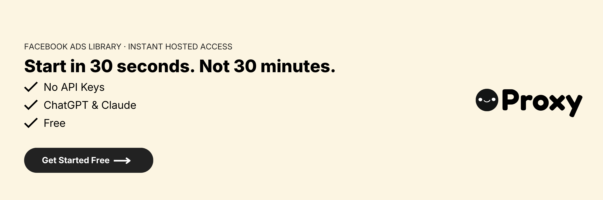

# Proxy Ad Library for Claude

Search the public ad libraries of Meta, Google, LinkedIn and TikTok from Claude, then turn what competitors run into creative strategy and ad scripts. Free to start, no API keys.

[Website](https://useproxy.dev/) · [Privacy](https://useproxy.dev/privacy) · [Terms](https://useproxy.dev/terms) · [Support](https://useproxy.dev/support)

Real-time access to the public ad libraries of Meta, Google, LinkedIn and TikTok from a conversation with Claude. No API keys: sign in once with OAuth.

## Use it

Ask Claude about a brand, for example "Show Nike's active Meta ads", "Who are Canva's main competitors?" or "Transcribe Anysphere's first TikTok ad". Claude looks up the brand, pulls its currently running ads, analyzes images and video creatives, finds competitors and writes competitive briefs.

Proxy is read-only. It cannot create or publish ads, and private performance data such as conversion rate or ROAS is not available.

## Install

- **Claude (claude.ai, desktop, mobile):** add Proxy from the Claude directory and sign in once.
- **Claude Code:** `/plugin marketplace add proxy-intell/claude-plugin`, then `/plugin install proxy-ad-library@proxy`.
- **Other MCP clients (ChatGPT, Cursor):** connect `https://mcp.useproxy.dev/mcp?ref=claude-plugin`, or see [useproxy.dev/welcome](https://useproxy.dev/welcome).

## Example prompts

- "How many ads is Anthropic running on Meta, and what's the split between video and image?"
- "Compare the advertising strategies of Nike, Adidas and Under Armour."
- "Who are Canva's main competitors? Show me what they run on Google."
- "Analyze Nike's top video ads and write me three scripts in the same structure for my product."
- "Run a creative strategy for my meal-planning app based on what its competitors are running."

## Skills

- `get-started`: runs a first lookup right after install
- `competitor-research`: what a brand runs across platforms, and who else competes

One skill per Proxy playbook. Each loads the current method from the server with `get_playbook`, so it stays up to date ([what each delivers](https://useproxy.dev/playbooks)):

- `competitor-ad-teardown`: angles, offers and formats competitors keep funding, plus the gaps
- `ad-script-writing`: original scripts and hooks built on long-running video ad structures
- `winning-product-research`: products other stores keep scaling with ads
- `product-validation`: go or no-go on one product or market, country by country
- `digital-offer-research`: courses, ebooks and low-ticket funnels that keep paying for ads
- `who-is-advertising`: which prospects run ads, with a pitch opener for each
- `brand-ad-audit`: scorecard of one brand's ads against category leaders
- `ad-swipe-file`: ad references grouped by visual pattern, with design briefs
- `landing-page-teardown`: the pages long-running ads point to
- `holiday-ad-campaigns`: Black Friday and seasonal campaigns, week by week
- `competitor-ad-watch`: what competitors launched, dropped and kept since last time

## Data

Brand names, search terms and ad IDs you ask about are sent to the Proxy server at mcp.useproxy.dev, which queries the public ad libraries through a data provider (ScrapeCreators) and returns the results. When you ask for image or video analysis, the ad's public media is sent to Google's Gemini model to produce a description and transcript. Your account email is used for sign-in and usage limits. Privacy policy: https://useproxy.dev/privacy. Support: https://useproxy.dev/support.

## For AI agents

Hosted MCP server: `https://mcp.useproxy.dev/mcp?ref=claude-plugin` (streamable HTTP, OAuth on first connect, no API key). Manifest: [`server.json`](server.json). Setup for every client: https://useproxy.dev/llms.txt
